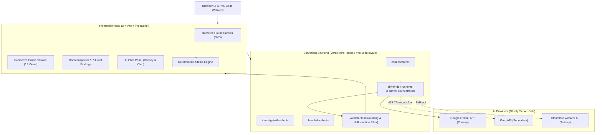

# The Living Blueprint (Velocity)

> **Visual software-architecture house and deterministic evidence engine for AI-generated code.**
> Know what AI coding agents have actually built, what remains incomplete, and what the evidence proves.

[](#testing--verification)
[](https://www.typescriptlang.org/)
[](https://vitejs.dev/)
[](https://react.dev/)
[](https://vercel.com/)

---

## Table of Contents

- [Overview](#overview)
- [Core Capabilities](#core-capabilities)
  - [1. Isometric Architecture House](#1-isometric-software-architecture-house)
  - [2. Deterministic Status Engine & Evidence Firewall](#2-deterministic-status-engine--evidence-firewall)
  - [3. Multi-Lens Interactive Architecture Graph (12 Views)](#3-multi-lens-interactive-architecture-graph-12-views)
  - [4. Real GitHub Repository Ingestion & CI Telemetry](#4-real-github-repository-ingestion--ci-telemetry)
  - [5. Dual-Persona AI Companions (Barkley & Cleo)](#5-dual-persona-ai-companions-barkley--cleo)
  - [6. Evidence-Backed Investigation & 7-Level Findings](#6-evidence-backed-investigation--7-level-findings)
  - [7. Closed-Loop Fix Verification Lifecycle](#7-closed-loop-fix-verification-lifecycle)
  - [8. Resilient 3-Tier AI Fallback Architecture](#8-resilient-3-tier-ai-fallback-architecture)
  - [9. Static Simulation Workbench & Request Journeys](#9-static-simulation-workbench--request-journeys)
  - [10. Workspace Persistence & Session Recovery](#10-workspace-persistence--session-recovery)
  - [11. Embedded VS Code Extension](#11-embedded-vs-code-extension)
  - [12. Built-in Demo Repository](#12-built-in-demo-repository)
- [Architecture & Tech Stack](#architecture--tech-stack)
- [Quick Start](#quick-start)
- [Environment Configuration](#environment-configuration)
- [Testing & Verification](#testing--verification)
- [Security & Grounding Principles](#security--grounding-principles)

---

## Overview

When developers work with autonomous coding agents, reviewing pull requests and massive diffs becomes a bottleneck. Code that merely exists or compiles is not proof of working functionality.

**The Living Blueprint** reconstructs codebases into an explorable, isometric architectural house. Rooms represent core architectural domains (foundation, core, services, gateway) backed by real test runs, commit trees, and GitHub Actions CI checks.

---

## Core Capabilities

### 1. Isometric Software-Architecture House
- **Visual Domain Mapping**: Maps source code, manifests, and dependencies into an interactive SVG house with dynamic isometric projection (`isoX`, `isoY`, depth sorting).
- **Dynamic Derivation**: Automatically generates architectural layers and rooms from scanned repositories (no hardcoded room templates).
- **Layer Organization**: Categorizes subsystems into `foundation`, `core`, `service`, and `gateway`.
- **Accessible Navigation**: Accessible hitboxes, keyboard navigation, warm amber selection highlights, and transparent wireframe roof structures that never block pointer interaction.

### 2. Deterministic Status Engine & Evidence Firewall
- **5 Unambiguous Evidence States**:
  - `verified`: Passing automated tests, confirmed CI workflow runs, or validated runtime evidence.
  - `implemented`: Source code exists, but automated verification is missing or incomplete.
  - `planned`: Defined in scope or architecture, but implementation is absent.
  - `blocked`: Active test failure, broken dependency, or failing CI check.
  - `unknown`: Insufficient or contradictory evidence without supersession.
- **Architectural Firewall**: AI models **cannot** mutate room status directly. Even if an LLM asserts a feature is complete, only deterministic test and CI evidence can transition a room to `verified`.
- **4-Step Evidence Chains**: Traces `Requirement/Behavior` → `Source Implementation` → `Relevant Test` → `Exact-Commit CI Check`.
- **Claim Separation**: Truthfully distinguishes four distinct claims: *test file detected*, *test references code*, *test executed*, and *test passed*.

### 3. Multi-Lens Interactive Architecture Graph (12 Views)
An interactive SVG/canvas visualization supporting zoom, pan, search, filtering, and full-screen reading modes:
1. **Workflow / Architecture View**: End-to-end topological pipeline mapping data flows and dependencies.
2. **Module Hierarchy**: Directory clusters, module imports, and circular dependency detection.
3. **Function Call Graph**: Caller-callee relationships with source excerpts.
4. **Control Flow Graph (CFG)**: Branch decisions, loops, conditions, returns, and throw points.
5. **Data Flow Analysis (DFG)**: Variable taint tracking from input sources through validation barriers to storage sinks.
6. **Call Sequence View**: Step-by-step request journeys across micro-components.
7. **State Transition Lens**: Explicit enums, state constants, string unions, and transition branches.
8. **Data / Schema Lens**: SQL DDL, Prisma models, Zod/Joi schemas, and typed data interfaces with foreign keys.
9. **Configuration Wiring Lens**: Maps environment variables and configuration sources to consumer modules (with secret value redaction).
10. **Error Path Lens**: Resolves try/catch blocks, explicit throw statements, and route-level HTTP failure handlers.
11. **Static Simulation Mode**: Step-by-step dry-run simulation of execution paths with branch conditions.
12. **Evidence Chain View**: Visual verification graph linking requirements to tests and commit-specific CI runs.
- **Full-Screen Modal**: Reusable [ExpandedVisualizationShell](file:///c:/Users/rspma/Downloads/Velocity/src/components/ExpandedVisualizationShell.tsx) with non-colliding labels, cycle-breaking topological ranking, and focus restoration.

### 4. Real GitHub Repository Ingestion & CI Telemetry
- **Bounded Scanning**: Ingests public repositories via GitHub REST APIs with bounded tree inspection (prioritizing critical entrypoints, manifests, and test files).
- **Exact-Commit CI Verification**: Fetches GitHub Actions check runs (`/commits/{ref}/check-runs` with `/actions/runs` fallback) tied strictly to the scanned commit SHA.
- **Telemetry Drawer**: Real-time inspection of API rate limits, scanned tree entries, inspected files, commit SHA, and check-run results.
- **Truthful Provenance**: Distinct UI badges differentiate between **Live Scanned Data**, **Saved Workspace Data**, and **Sample Data**.

### 5. Dual-Persona AI Companions (Barkley & Cleo)
A unified single-model call per turn produces natural dual-persona responses:
- **Barkley (Dog)**: Friendly, encouraging guide. Delivers upfront plain-English summaries, line-by-line code walkthroughs, and architectural rationales.
- **Cleo (Cat)**: Sharp, skeptical reviewer. Joins selectively when she identifies unverified assumptions, brittle logic, or missing test proof.
- **Adaptive Pedagogies**: Configurable for `beginner` (analogies, plain terms), `intermediate` (control flow, module mechanics), and `technical` (exact assertions, HTTP codes) modes.
- **Prompt Injection Defense**: Scanned code and READMEs are strictly isolated as untrusted data.

### 6. Evidence-Backed Investigation & 7-Level Findings
Deep room-level inspection generating actionable, grounded findings:
1. **Finding Header**: Category, severity (`blocker`, `warning`, `info`), and evidence classification (`observed` vs `inferred`).
2. **Why It Matters**: Explains real user-visible and system-level impact.
3. **Validated Code Evidence**: Verified file paths, 1-indexed line ranges (e.g. `L12-L18`), source excerpts, and dynamic jump buttons.
4. **Reasoning**: Distinct separation of observed facts (`✓`) from architectural inferences (`↳`).
5. **Unknowns**: Transparent disclosure of uninspected files and unverified assumptions.
6. **Recommended Next Steps**: Specific test commands, files to edit, or questions to resolve.
7. **Copy-Ready Repair Prompt**: Self-contained prompt formatted for autonomous coding agents with reproduction steps, exact lines, and acceptance criteria.
- **Interactive Jumps**: One-click navigation to Graph Canvas, Static Simulation, Test Evidence, or Source Excerpt.

### 7. Closed-Loop Fix Verification Lifecycle
- **Fix Reporting**: Submit PR URLs or commit SHAs to verify implemented repairs.
- **Re-Inspection Engine**: Compares diff budgets against commit changes and verifies repository identity.
- **Failure Supersession**: Once new CI check runs confirm passing tests on the new commit, the engine supersedes older blocked statuses and marks the room verified.

### 8. Resilient 3-Tier AI Fallback Architecture
All LLM requests execute server-side with zero credential leakage:
- **Tier 1 (Primary)**: Google Gemini (`gemini-3.8-flash`).
- **Tier 2 (Secondary Fallback)**: Groq (`qwen/qwen3.8-27b`).
- **Tier 3 (Tertiary Fallback)**: Cloudflare Workers AI (`@cf/meta/llama-3.3-70b-instruct-fp8-fast`).
- **Automatic Failover**: Seamless failover on HTTP 429 quota exhaustion, short-term rate limits, upstream timeouts, or 5xx server errors.
- **Performance Optimizations**: Commit-keyed prompt memoization (<1ms warm prep), request deduplication, and `AbortController` cancellation.

### 9. Static Simulation Workbench & Request Journeys
- **Safe Static Dry-Runs**: Simulates execution flow, input validation, and decision branching without executing untrusted code.
- **Scenario Generation**: Generates valid, invalid, boundary, and edge-case scenarios derived from parameter types and test suites.
- **Step-by-Step Inspector**: Visualizes active line, scope variables, and branch conditions at each step.

### 10. Workspace Persistence & Session Recovery
- **Local Storage Management**: Saves project workspaces, custom scans, investigation findings, and chat history.
- **Secret Redaction**: Automatically scrubs API keys, tokens, and credentials prior to local persistence.
- **Recent Project Switcher**: Easily switch between investigated repositories with isolated findings and room states.

### 11. Embedded VS Code Extension (v0.2.0)
Located in [`vscode-extension/`](file:///c:/Users/rspma/Downloads/Velocity/vscode-extension):
- **Local Installation**: Install `living-blueprint-vscode-0.2.0.vsix` via `code --install-extension living-blueprint-vscode-0.2.0.vsix` or download directly from `/api/download/extension`.
- **Workspace Architecture Discovery**: Automatically scans opened projects in VS Code with bounded safety and `.git`/`node_modules` pruning.
- **Architecture Lenses & Interactive Canvas**: Overview, Flow, Components, and Status lenses embedded directly in a native webview.
- **Investigation, Findings & Re-Inspection**: Deep room inspection, clickable line ranges, copy-ready repair prompts, and a dedicated re-inspection engine.
- **Click-to-Line Navigation**: Clicking any node or file reference immediately opens the file at the exact line in VS Code.
- **Secure SecretStorage & Per-Folder Consent**: Stores Gemini, Groq, and Cloudflare credentials in native VS Code secret storage; per-folder AI consent defaults to off.
- **Offline by Default**: Operates 100% locally without sending code to external APIs unless explicitly authorized.

### 12. Built-in Demo Repository
Located in [`demo-repository/`](file:///c:/Users/rspma/Downloads/Velocity/demo-repository):
- **Patchboard Tasks API**: A standalone Node.js REST API service with an intentional whitespace-validation defect.
- **Failing CI Baseline**: Features an authentic failing test (`rejects whitespace-only task titles`) and GitHub Actions workflow for end-to-end testing of defect detection and fix lifecycles.

---

## Architecture & Tech Stack



- **Frontend**: React 18, TypeScript 5.6, Vite 5.4, D3.js, React Flow.
- **Styling**: Vanilla CSS design system with coffee/slate palette, glassmorphism, and responsive layouts.
- **Backend**: Node.js HTTP handlers shared between local Vite middleware (`vitePluginAiChat.ts`) and Vercel Serverless Functions (`api/`).
- **Target Compatibility**: Node 18+, Vercel Serverless (Hobby & Pro, `maxDuration: 30`).

---

## Quick Start

### 1. Prerequisites
- **Node.js**: v18.0.0 or higher
- **npm**: v9.0.0 or higher
- Modern web browser (Chrome, Edge, Firefox, Safari)

### 2. Installation
```bash
# Clone the repository
git clone https://github.com/sakshamgupta005/Velocity.git
cd Velocity

# Install root dependencies
npm install
```

### 3. Running Locally
```bash
# Start Vite development server with local AI middleware
npm run dev
```
Open [http://localhost:3000](http://localhost:3000) in your browser.

### 4. Building for Production
```bash
npm run build
```

---

## Environment Configuration

AI capabilities execute server-side. Create a `.env` file in the project root:

```env
# Primary Provider: Google Gemini
GEMINI_API_KEY="your-gemini-api-key"
AI_MODEL="gemini-3.8-flash"

# Secondary Fallback: Groq (Optional)
GROQ_API_KEY="your-groq-api-key"
GROQ_MODEL="qwen/qwen3.8-27b"

# Tertiary Fallback: Cloudflare Workers AI (Optional)
CLOUDFLARE_ACCOUNT_ID="your-cloudflare-account-id"
CLOUDFLARE_API_TOKEN="your-cloudflare-api-token"
CLOUDFLARE_AI_MODEL="@cf/meta/llama-3.3-70b-instruct-fp8-fast"
```

> [!NOTE]
> If no API keys are provided, the application continues to operate fully for repository scanning, architecture mapping, graph rendering, and deterministic status verification. AI chat and investigations gracefully present configuration instructions without crashing.

Verify your server configuration securely without exposing keys:
```bash
curl -s http://localhost:3000/api/health
```

---

## Testing & Verification

The project includes 627 automated tests (445 web & root test runner tests + 182 VS Code extension tests) executing via Node's native test runner:

```bash
# Run web and API automated tests (445 tests)
npm test

# Run VS Code extension automated tests (182 tests)
cd vscode-extension && npm test
```

### Key Test Suites
- [statusEngine.test.ts](file:///c:/Users/rspma/Downloads/Velocity/test/statusEngine.test.ts): Deterministic 5-status derivation and evidence supersession.
- [githubScanner.test.ts](file:///c:/Users/rspma/Downloads/Velocity/test/githubScanner.test.ts): Bounded git tree ingestion and rate-limit recovery.
- [aiCompanion.test.ts](file:///c:/Users/rspma/Downloads/Velocity/test/aiCompanion.test.ts): Single-payload dual-companion dialogue and injection defense.
- [investigation.test.ts](file:///c:/Users/rspma/Downloads/Velocity/test/investigation.test.ts): 7-level finding validation and repair prompt generation.
- [interactiveGraphCanvas.test.ts](file:///c:/Users/rspma/Downloads/Velocity/test/interactiveGraphCanvas.test.ts): 12 architectural view modes and graph layout.
- [evidenceChain.test.ts](file:///c:/Users/rspma/Downloads/Velocity/test/evidenceChain.test.ts): Commit-specific CI evidence and test mapping.
- [aiProviderFallback.test.ts](file:///c:/Users/rspma/Downloads/Velocity/test/aiProviderFallback.test.ts): Multi-tier failover (Gemini → Groq → Cloudflare).
- [workspacePersistence.test.ts](file:///c:/Users/rspma/Downloads/Velocity/test/workspacePersistence.test.ts): Credential scrubbing and session recovery.

---

## Security & Grounding Principles

1. **Zero Key Exposure**: Secret API keys never enter client-side code, webviews, or browser bundles.
2. **Deterministic Truth**: The status of software requirements is governed strictly by verifiable tests and commit-matched CI runs, never by conversational AI assertions.
3. **Untrusted Code Isolation**: External code and repository contents are parsed as untrusted text with strict anti-injection sanitization.
4. **Honest Provenance**: Real scanned data, restored workspace sessions, and pre-canned sample datasets are clearly demarcated across the entire interface.
